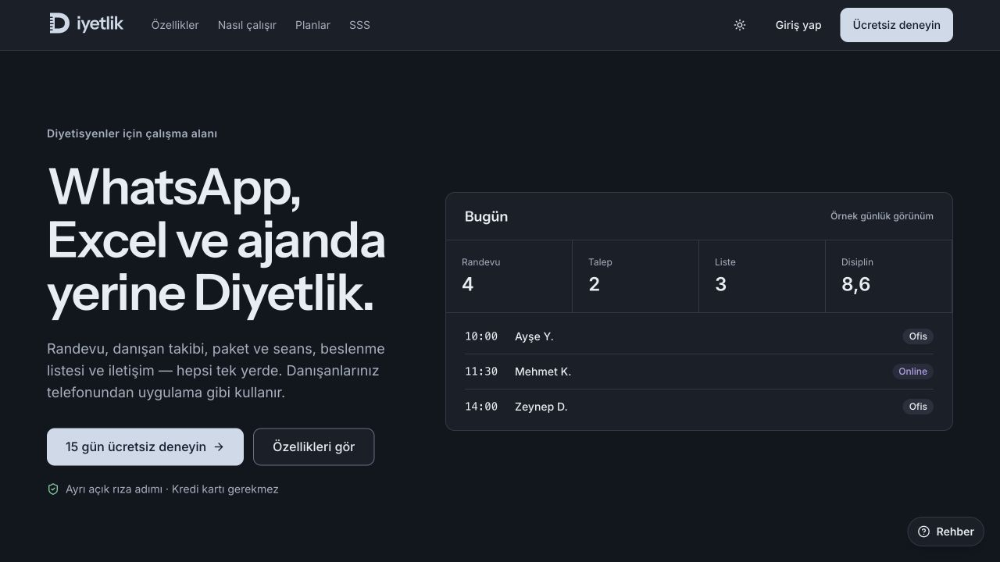
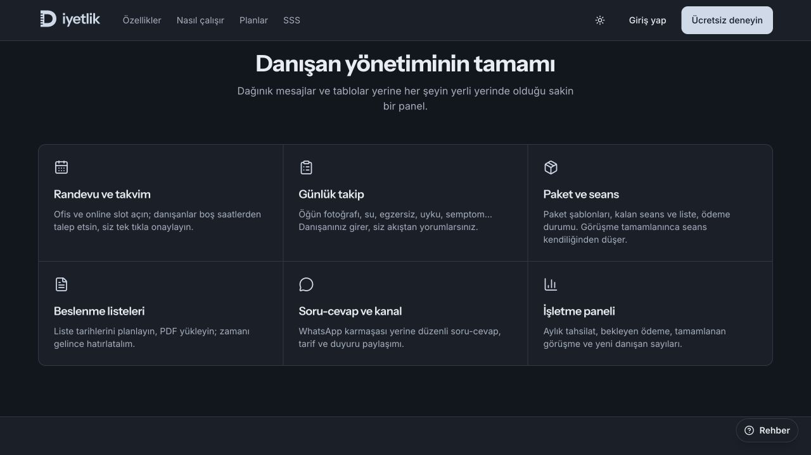
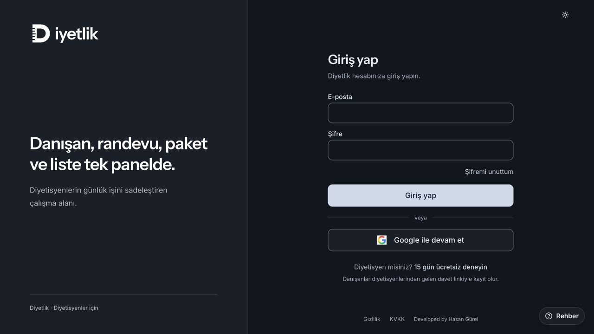

# Diyetlik

**Client management and daily workflows for dietitians.**

[Visit the live product](https://diyetlik.com) · [Hasan Gürel](https://hasangurel.com)

## The product

Diyetlik brings appointments, client follow-up, session packages, nutrition documents and communication into one workspace. It includes separate dietitian and client areas and a progressive web application structure.

### Development focus

- Role-based dietitian and client workspaces.
- Appointment requests, calendar availability and appointment status transitions.
- Package limits, remaining sessions and document workflows.
- Client tracking, communication and business summaries.
- Domain rules separated from interface code, with tests for appointment states, package status, plan limits and time zones.

## Technologies

React · TypeScript · Vite · Tailwind CSS · Supabase · TanStack Router / Query

## Explore

[Overview](https://diyetlik.com) · [Sign in](https://diyetlik.com/auth)

## Screenshots

Captured from the live public website on **8 November 2026**. Product content, visual design and prices may change.

### Public overview of the application modules

### Public sign-in screen

## Access and scope

The landing page includes an illustrative daily dashboard. Authenticated workspaces require an authorized account; no real client records are shown here.

Application source code is private. This repository contains a project presentation and public screenshots only. Brand names and product imagery belong to their respective owners.

---

Development portfolio by **Hasan Gürel** · [hasangurel.com](https://hasangurel.com) · [Contact](mailto:hasangurel9@hotmail.com)
